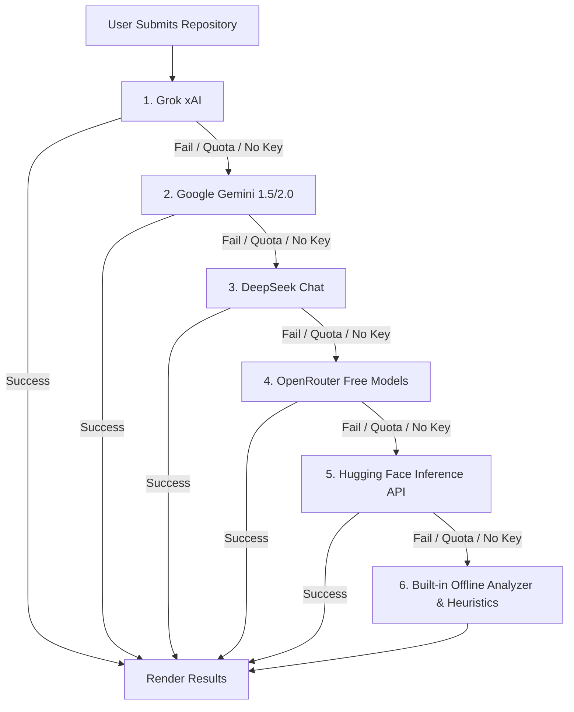

# ⚡ GitHub Repository Explainer & Developer Tool Suite

An AI-powered developer intelligence platform that transforms any GitHub repository into an interactive architectural blueprint, senior-engineer conceptual breakdown, contextual Q&A chatbot, and deep code explorer.

---

## 🌟 Core Features & Architecture Tools

### 1. 📖 Code Explanation & Executive Summary
- **Senior Engineer Mental Models:** Teaches the repository concepts from first principles using analogies, practical walkthroughs, and architectural pillars rather than regurgitating the README.
- **Automated Tech Stack Detection:** Automatically analyzes file trees and manifests (`package.json`, `requirements.txt`, `Cargo.toml`, `go.mod`, etc.) to detect frameworks, databases, languages, styling libraries, and devops tooling.
- **Executive Takeaways:** High-impact bulleted summary of key architectural decisions, target audience, and best practices.
- **Export & Sharing:** Copy to clipboard or export directly as Markdown (`.md`).

### 2. 🏗 Interactive Architecture Flow (Powered by ReactFlow)
- **Component-Driven Visual Blueprint:** Displays visual diagrams representing Clients, Ingress Gateways, Core Business Engines, Persistence Stores, Cache layers, and Async Queues.
- **Custom Categorized Nodes:** Color-coded node system with category tags, technology pills, and responsibilities.
- **Interactive Component Inspector:** Click any component to inspect inbound sources, outbound targets, tech stack, and role.
- **Interactive Editing:** Add custom components, edit node labels, delete components, or connect custom edges.
- **Layout Switching:** Toggle between Vertical (Top-to-Bottom) and Horizontal (Left-to-Right) layouts.
- **Mermaid Export:** Generates clean ````mermaid`` code ready to copy and paste directly into GitHub READMEs!
- **JSON Export:** Download full ReactFlow diagram specifications.

### 3. 🤖 AI Chatbot Q&A
- **Repository-Contextual Assistant:** A dedicated senior-architect AI conversational partner primed with the repository's metadata, tech stack, file tree, and architecture.
- **Quick Question Chips:** One-click shortcuts for setup instructions, dependency audits, architecture deep dives, entry point discoveries, and testing workflows.
- **Formatted Responses:** Rich markdown rendering with language-tagged code blocks, one-click code copy, and retry support.
- **Offline Intelligence Fallback:** Answers repository questions intelligently even when external AI API keys are not provided.

### 4. 📁 Code Explorer & AI File Explainer
- **Interactive File Tree:** Browse folders and files with syntax-specific file icons and real-time name filtering.
- **Syntax-Formatted Code Viewer:** Line-numbered viewer with file path breadcrumbs, line counts, and one-click code copy.
- **🧠 AI File Explainer:** Click "Explain File" on any selected file to generate a targeted senior-engineer walkthrough of its purpose, exported interfaces, and architectural role.
- **Direct GitHub Jump:** Quick-link directly to the live GitHub file view.

---

## 🛠 Multi-Provider LLM Fallback Engine

The platform features an automated cascade with zero-configuration resilience:



1. **Grok (xAI):** High-speed conversational mentor responses.
2. **Google Gemini:** Multimodal depth and low-latency structured JSON generation.
3. **DeepSeek:** Cost-effective, high-reasoning coding analysis.
4. **OpenRouter:** Access to free open-weights models (`llama-3.2`, `gemma-2`, `qwen-2.5`).
5. **Hugging Face:** Open-source model inference API.
6. **Built-in Offline Intelligence Engine:** Even with zero API keys or during complete network rate limits, the app extracts real file trees, parses package descriptors, identifies tech stacks, and builds interactive architecture graphs.

---

## 🚀 Quick Start

### Prerequisites
- Node.js 18+ (tested on Node.js 18, 20, 22, and 24)
- npm or yarn

### Installation

```bash
# Clone the repository
git clone https://github.com/agrwl-utkarsh/mini2.git
cd mini2

# Install dependencies
npm install

# (Optional) Copy environment template and add your preferred API keys
cp .env.example .env

# Run local development server (includes full local API middleware!)
npm run dev
```

Visit `http://localhost:5173` in your browser.

> **Note on Local Development:** The Vite dev server is bundled with custom API middleware in `vite.config.js` that mimics Vercel serverless functions locally. All endpoints (`/api/analyze`, `/api/chat`, `/api/file`) work out of the box in `npm run dev`!

---

## ⚙️ In-App API Key Configuration

You do **not** need to restart your server to change API keys. Click the **⚙️ API Keys** button in the top navigation bar to configure keys directly in your browser. Keys are stored safely in `localStorage` and sent only with your explicit requests.

---

## 📦 Project Structure

```
├── api/
│   ├── analyze.js           # Repository analysis, metadata extraction, tech stack detection, fallback generator
│   ├── chat.js              # Context-aware AI Chatbot Q&A endpoint with multi-provider fallback
│   └── file.js              # Raw file content fetcher and single-file AI explainer
├── src/
│   ├── components/
│   │   ├── ArchitectureFlow.jsx # Interactive ReactFlow architecture graph & editor
│   │   ├── Chatbot.jsx          # AI Q&A conversational interface
│   │   ├── CodeExplorer.jsx     # Repository file tree browser & syntax viewer
│   │   ├── CodeExplanation.jsx  # Structured markdown explanation & executive summary
│   │   └── SettingsModal.jsx    # API key management dialog
│   ├── App.jsx              # Main layout, state coordination, and tab management
│   ├── App.css              # Modern CSS design system (Dark & Light theme)
│   └── main.jsx             # React entry point
├── index.html               # HTML entry point with preconnect font optimizations
├── vite.config.js           # Vite configuration with integrated local API middleware
├── vercel.json              # Vercel deployment and serverless function configuration
└── package.json             # Dependencies and build scripts
```

---

## ☁️ Deployment to Vercel

1. Push your repository to GitHub.
2. Import the project in the [Vercel Dashboard](https://vercel.com).
3. (Optional) Add your environment variables in Vercel Project Settings:
   - `GEMINI_API_KEY`
   - `GROK_API_KEY`
   - `DEEPSEEK_API_KEY`
   - `OPENROUTER_API_KEY`
   - `HUGGINGFACE_API_KEY`
   - `GITHUB_TOKEN`
4. Click **Deploy**. Vercel will build the Vite frontend and host the `api/*.js` routes as Edge/Serverless functions automatically.

---

## 📄 License

MIT License. Contributions and feedback are welcome!
